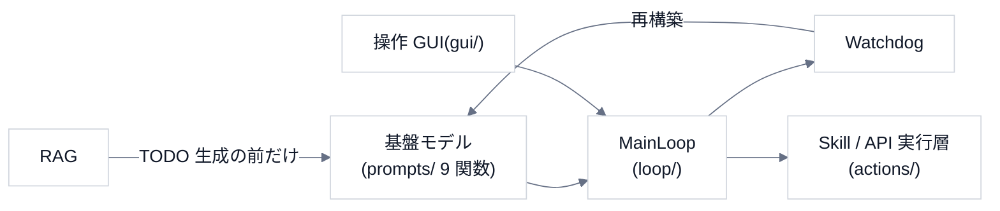

# VLMAutoReplayTool

「基盤モデルによる**計画**」と「専用の部品による**実行**」を分離した、ゲーム自動プレイエージェントの**コア骨格**です。モデルは `Protocol` 越しで差し替えられ、本物のモデル・ゲーム・ドライバなしに、全体を決定的にテストできます。設計は [VLMAutoReplayTool_DESIGN.md](VLMAutoReplayTool_DESIGN.md)。


## 状態

| 項目 | 内容 |
|---|---|
| 実装範囲 | Phase 1〜5(プロンプト層・メインループ・実行層・RAG・Watchdog)と Phase 8(HUD)は**フル実装**。Phase 6・7(スキルの自動抽出・自己位置推定)は**軽量実装**(反復が前提) |
| テスト | `.venv/Scripts/pytest -q`(偽のモデル・偽のゲームで、全体を決定的に。文書の検査を含む) |
| 認証 | 既定は**なし**(`VLM_AUTH=off`。Host・Origin の検査だけ)。複数人なら `VLM_AUTH=required` |
| **GUI の実行** | **デモのゲーム・デモのモデルだけ**。実機・実モデルを GUI から動かすのは、まだ未配線 |
| 未検証 | ViGEm・SendInput の**実機での入力**・本物の VLM での挙動とコスト |
| 既知の問題 | [トラブルと保守](docs/learn/06-troubleshooting-maintenance.md)(サンドボックスは破れる・観測の画像はメモリのみ 等) |

## クイックスタート

```bash
python -m venv .venv
.venv/Scripts/pip install -e ".[dev,gui]"
.venv/Scripts/pytest -q                              # 全部
.venv/Scripts/python -m vlm_auto_replay.gui          # http://127.0.0.1:8765(デモ)
```

ブラウザで開き、**ゴール分解 → 実行開始**。デモのゲームが動き、StepLog がライブで積み上がります(手順の詳細は [旧 README](docs/reference/setup-and-operations.md))。

## 設計の軸

- **計画(モデル)と実行(専用の部品)を分ける**: モデルは遅く・高く・間違えるので、毎フレームは任せない。
- **差し替え可能**: 基盤モデルは `FoundationModelClient`(`Protocol`)越し。ベンダー名をループの本体に埋め込まない。
- **監査可能**: 行動の前に、**理由**を必ず記録する(空なら実行しない)。
- **RAG は TODO 生成の前だけ**: 行動の生成には持ち込まない(`import` しないことで守る)。
- **API は許可リスト**: モデルが返した文字列で、内部の関数を呼ばせない。
- **停滞に強い**: Watchdog が、診断または N ステップで、TODO を作り直す。



## ドキュメント

| 読みたいもの | 場所 |
|---|---|
| 全体の地図 | [docs/index.md](docs/index.md) |
| **基礎から学ぶ**(講義 6 回・実行できる例つき) | [docs/lecture/](docs/lecture/index.md) |
| **保守・拡張する**(全体像・コードの読み方・レシピ・テスト・トラブル・用語集) | [docs/learn/](docs/learn/index.md) |
| 動作確認の手順・認証・環境変数の**詳細**(旧 README) | [docs/reference/setup-and-operations.md](docs/reference/setup-and-operations.md) |
| 各 Phase の図・技術解説 | [docs/TECHNICAL_OVERVIEW.md](docs/TECHNICAL_OVERVIEW.md)・[HTML 版](docs/technical-overview.html) |
| 設計書・UI 設計 | [VLMAutoReplayTool_DESIGN.md](VLMAutoReplayTool_DESIGN.md)・[UI](VLMAutoReplayTool_UI_DESIGN.md) |
| 改善の設計と計画(2026-10) | [IMPROVEMENT_DESIGN_2026-10.md](IMPROVEMENT_DESIGN_2026-10.md)・[IMPROVEMENT_PLAN_2026-10.md](IMPROVEMENT_PLAN_2026-10.md) |

## セキュリティの要点

- 操作 GUI の `POST /api/run/start` は、**実際にキー入力・クリックを起動**しうるので、**Host の許可リスト**(DNS rebinding)と**変更操作の Origin**(CSRF)を常に検査します。別のホスト名で開くときは `VLM_ALLOWED_HOSTS` に足す。
- 複数人で使うときは `VLM_AUTH=required`(ユーザーが 0 人なら起動しない)。役割は `viewer`(見る)・`operator`(実行の開始・停止)・`admin`(スキル・HID の変更)。**スキルの追加は admin だけ**(script は Python のコード)。
- **script スキルのサンドボックスは、ブロックリスト方式で、完全な境界ではありません**。他人のコード・ネットで拾ったコードは、動かさないでください(OS の分離が要る)。
- 秘密(API キー)は**環境変数**で。リポジトリに書かない。

## 限界(正直に)

- GUI は**デモの実行**だけです(実機・実モデルは、ライブラリとして使う)。
- 観測の画像は**メモリ**にだけ持ち、再起動や次の実行で消えます(履歴の StepLog は残る)。
- Phase 6・7 は**軽量実装**で、精度は未評価です。Watchdog の既定の閾値(15)は**初期値**です。
