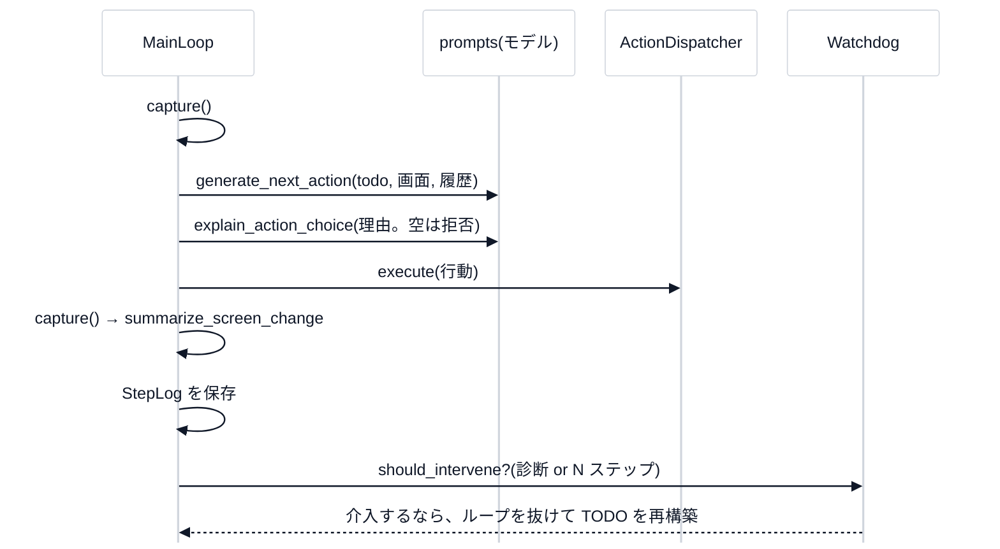

# 1. 全体像

## 何をするものか

**基盤モデル(VLM)に「計画」を、専用の部品に「実行」を任せる**、ゲーム自動プレイエージェントのコア骨格です(講義[第 0 回](../lecture/00-introduction.md))。モデルは `Protocol` 越しで差し替えられ、本物のモデル・ゲーム・ドライバなしに、全体をテストできます。

## Phase と場所の対応

| Phase | 内容 | 場所 | 状態 |
|---|---|---|---|
| 1 | プロンプト層(9 つの型つきの関数) | `src/vlm_auto_replay/prompts/` | 実装 |
| 2 | メインループ + StepLog | `loop/main_loop.py` | 実装 |
| 3 | Skill/API の実行層・HID・サンドボックス | `actions/` | 実装(ViGEm・SendInput は**実機ドライバ依存**・未検証) |
| 4 | 知識(RAG は TODO 生成の前だけ) | `knowledge/` | 実装 |
| 5 | Watchdog + TODO の再構築 | `loop/watchdog.py` | 実装 |
| 6 | スキルの自動抽出 + 受け入れゲート | `skills/` | **軽量実装**(`TODO(Phase6反復)`) |
| 7 | 視覚的な自己位置推定 | `navigation/` | **軽量実装**(`TODO(Phase7反復)`) |
| 8 | 監視 HUD | `gui/hud_broadcast.py` + `gui/static/` | 実装 |
| – | 操作 GUI(FastAPI) | `gui/` | 実装(**デモの実行だけ**。下) |

## 1 ステップの流れ

## 操作 GUI は、いまはデモの実行だけ

`gui/runtime.py` の `start_run` は、**`DemoGame` と `DemoExecutor`**(デモのゲーム)と、既定では**デモのモデル**(`DemoModelClient`)を使います。

- 「入力バックエンド(HID)」の設定は、`ApiPrimitives` を**組み立てて保持する**だけで、**デモの実行には使われません**(コード内のコメントにも「まだデモ実行フローには…」とある)。
- 実際のゲーム・実際の VLM で動かすには、**ライブラリとして**(`MainLoop` に、本物の `capture`・`executor` と `configure_model_client` を渡して)使う。GUI を本物につなぐのは、今後の作業。

## 状態の置き場所

| 何を | どこに | 再起動で |
|---|---|---|
| スキル・実行履歴(Run と StepLog) | SQLite `~/.vlm_auto_replay/gui.sqlite3` | 残る |
| 観測の画像 | **メモリ**(`RuntimeState.observations`) | 消える(履歴の `observationRef` から画像は引けなくなる) |
| いまの TODO・状態・HUD の購読 | メモリ | 消える |
| ユーザー(キーのハッシュ) | `~/.vlm_auto_replay/auth_users.json`(`VLM_AUTH_FILE`) | 残る |
| 監査ログ | `~/.vlm_auto_replay/audit.jsonl`(`VLM_AUDIT_LOG`) | 残る |

## 設定(環境変数)

| 名前 | 既定 | 意味 |
|---|---|---|
| `VLM_AUTH` | `off` | `required` で API キー認証を必須(ユーザーが 0 人なら起動しない) |
| `VLM_ALLOWED_HOSTS` | ループバックのみ | 許可する Host(DNS rebinding 対策) |
| `VLM_DEBUG` | 無効 | 監視 HUD を、本番でも有効にする(admin だけ) |
| `VLM_AUTH_FILE`・`VLM_AUDIT_LOG` | `~/.vlm_auto_replay/...` | ユーザーと監査ログの場所 |
| `VLM_CF_ACCESS_TEAM_DOMAIN`・`VLM_CF_ACCESS_AUD` | なし | Cloudflare Access の JWT を認証に使う |

## 主な API(`gui/server.py`)

| 場所 | 役割 | 最低の役割 |
|---|---|---|
| `GET /api/status`・`/api/history`・`/api/settings`・`/api/observation/{ref}` | 状態・履歴・設定・画像 | viewer |
| `POST /api/todo/decompose`・`/api/run/start`・`/api/run/stop` | ゴール分解・**実行の開始・停止** | operator |
| `POST /api/skills`・`DELETE /api/skills/{id}`・`POST /api/settings/hid-backend` | スキルの追加・削除・入力バックエンドの変更 | **admin** |
| `/ws/hud`・`/hud.html`・`/hud.js` | 監視 HUD | **admin**・`VLM_DEBUG`(本番) |
| `/admin.html`・`/admin.js` | 管理画面(別ページ) | admin |
