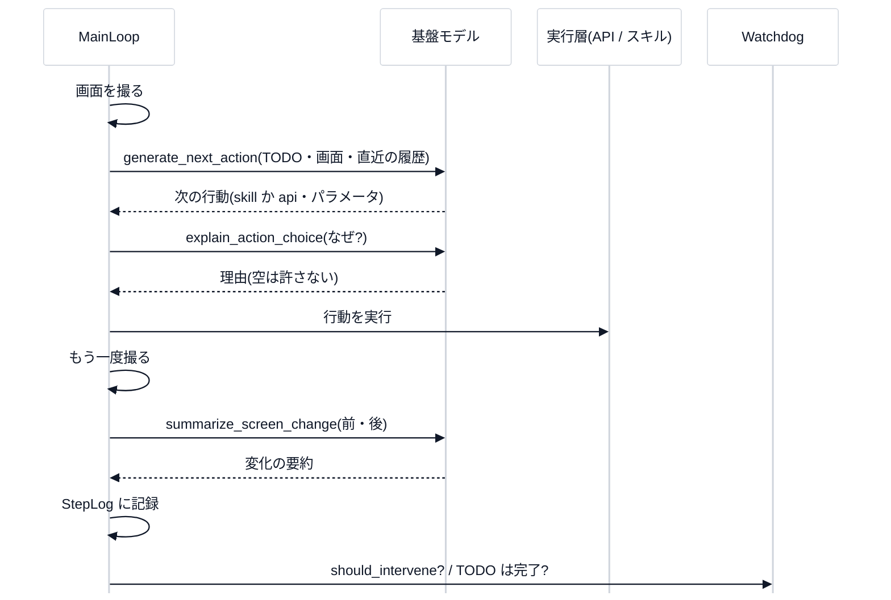

# 第 0 回 「計画」と「実行」を分けるゲーム自動プレイ(全体の見取り図)

> 所要時間の目安: 1.5 時間 / 前提: Python の基本(クラス・辞書・関数)

## この回のゴール

- ゲーム自動プレイエージェントの**設計の軸**(**基盤モデルは計画、専用の部品が実行**)を説明できる。
- 9 つの「プロンプト意図」と、メインループ・Watchdog・スキルの役割が分かる。
- **`Protocol` による差し替え**(本物のモデルを、テスト用の偽物に替える)を動かして確かめられる。

## 1. 解きたい問題

大きな言語モデル(VLM: 画像も見られる基盤モデル)に、ゲーム画面を見せて「次に何を押す?」と聞き続ければ、ゲームを遊ばせられそうです。でも、現実には:

- モデルの呼び出しは**遅く・高く**、毎フレームは呼べない。
- モデルは**ときどき間違える**・同じことを繰り返して**スタック**する。
- 何をしたか分からないと、**直せない**(監査できない)。

そこで、このツールは役割を**分けます**。

| 役割 | 担当 | 例 |
|---|---|---|
| **計画**(考える) | 基盤モデル(VLM) | 目標を TODO に分解・次の行動を選ぶ・停滞の原因を分析 |
| **実行**(動かす) | 専用の部品 | パッド・キーボード・マウスの入力・OCR・保存済みの**スキル** |
| **見張り** | Watchdog | 停滞を検知して、TODO を作り直す |

> **設計の軸**: 「基盤モデルによる計画」と「専用モデル・スキル・API による実行」を**分離**する。モデルは**差し替え可能**(特定のベンダー・モデル名をループの本体に埋め込まない)。


## 2. 9 つのプロンプト意図

モデルに頼むことを、**9 個の型つきの関数**にしました(`prompts/functions.py`)。

| # | 関数 | 頼むこと |
|---|---|---|
| 1 | `decompose_goal_to_todo` | 目標を TODO のリストに分解 |
| 2 | `explain_action_choice` | なぜその行動にしたか(1〜3 文) |
| 3 | `generate_next_action` | 次の行動を生成(画面を見て) |
| 4 | `extract_experience` | 再利用できる知見(落とし穴・ルール)を抽出 |
| 5 | `summarize_screen_change` | 画面の**観測できる変化だけ**を要約 |
| 6 | `merge_duplicate_operations` | 重複した操作を、差分をパラメータにして 1 つに |
| 7 | `generate_code_from_video_and_procedure` | 動画と手順書から Python のスキルを生成 |
| 8 | `extract_reusable_subroutine` | 再利用できるサブルーチンを切り出す |
| 9 | `diagnose_stall` | 停滞の原因と、次に試すことを特定 |

## 3. 1 ステップの流れ



## 4. 差し替える: `Protocol` と偽のモデル

モデルの呼び出しは、**1 つの入口**(`FoundationModelClient`・`Protocol`)だけを通ります。本物のクライアントでも、**決まった答えを順に返す偽物**(`ScriptedFoundationModelClient`)でも、呼ぶ側のコードは同じです。これで、**本物のモデル・ゲームなしに**、ループの全体をテストできます。

```python
# 実行できる
from vlm_auto_replay.prompts.functions import decompose_goal_to_todo
from vlm_auto_replay.prompts.model_client import (
    ScriptedFoundationModelClient,
    configure_model_client,
    reset_model_client,
)
from vlm_auto_replay.prompts.schemas import DecomposeGoalOutput, TodoItem

client = ScriptedFoundationModelClient()
client.queue("decompose_goal_to_todo", DecomposeGoalOutput(
    todos=[TodoItem(todoId="t1", description="ボスの部屋へ行く", doneCriteria="ボスが画面に映る"),
           TodoItem(todoId="t2", description="ボスを倒す", doneCriteria="勝利画面が出る")],
    ragContextUsed=["guide-1"],
))
configure_model_client(client)

result = decompose_goal_to_todo("ボスを撃破する", rag_context=["ボスは弱点を突くと早い"])
print("TODO の数:", len(result.todos), "/ 1 件目:", result.todos[0].description)
print("モデルに渡された内容:", client.calls[0]["task"], list(client.calls[0]["payload"]))

try:
    decompose_goal_to_todo("もう一度", rag_context=[])    # 答えを登録していない
except AssertionError as exc:
    print("登録がないと:", str(exc)[:42], "…")

reset_model_client()
try:
    decompose_goal_to_todo("未設定", rag_context=[])
except RuntimeError as exc:
    print("クライアント未設定:", str(exc)[:24], "…")
```

```text
# 出力
TODO の数: 2 / 1 件目: ボスの部屋へ行く
モデルに渡された内容: decompose_goal_to_todo ['goal', 'rag_context']
登録がないと: ScriptedFoundationModelClient: task='decom …
クライアント未設定: FoundationModelClientが未設 …
```

- **応答が登録されていない呼び出しは、失敗**する(黙って空の答えを返さない)。テストが「想定外の呼び出し」に気づける。
- **クライアントが未設定**なら、はっきりしたエラー。

## 確認問題

1. 計画をモデルに、実行を専用の部品に分けるのは、なぜですか。
2. モデルの呼び出しを、1 つの入口(`Protocol`)にまとめる利点は。
3. `ScriptedFoundationModelClient` で、登録のない `task` を呼ぶと、なぜ失敗させるのですか。
4. 行動の**理由**を、行動の前に必ず記録するのは、なぜですか。

## 解答

1. モデルは遅く・高く・間違えるので、毎フレーム任せられない。**速く確実な部品**(入力・保存済みのスキル)に実行を任せ、モデルは**高い判断**だけに使う。
2. モデルを**差し替えられる**(ベンダー・モデル名に依存しない)。本物なしで**決定的にテスト**できる。
3. 想定外の呼び出しを**黙って通すと**、テストが「たまたま通った」状態になる。失敗させて、**何が呼ばれたか**を見えるようにする。
4. 何をしたか分からないと、直せない(**監査可能性**)。理由が空なら、実行しない(第 2 回)。

## まとめ

- **計画(モデル)と実行(専用の部品)を分ける**。モデルは `Protocol` 越しで、差し替えられる。
- 9 つの意図 = 9 つの型つきの関数。メインループ・Watchdog・スキルが、その上に組み合わさる。
- 偽のモデルで、ゲームなしに、全体を決定的にテストできる。
- 次の回は、その**型つきのプロンプト層**(Pydantic と RAG の境界)。
